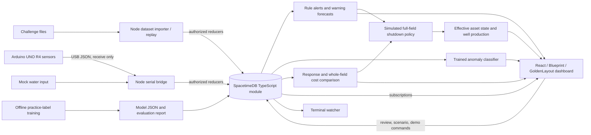

# Ghidorah stack and project map

Open the repository root `TeamGhidorahHackUTD26` in PyCharm. The two applications are `backend/` and `frontend/`. `npm.cmd run setup` installs both, and `npm.cmd run dev` starts the database/backend and dashboard together. Open http://127.0.0.1:5173. The database listens on loopback port 3000.

The decision code runs inside SpacetimeDB reducers. The React app reads subscribed tables; it does not independently decide to shut down a field. The Node bridge ingests measurements only. There is no command channel back to equipment.

| Layer | Files | Responsibility |
|---|---|---|
| Repository startup | `package.json`, `scripts/dev.mjs` | Install/start both applications; stop only processes started by this launcher |
| Backend startup | `backend/scripts/dev.ts`, `backend/scripts/cli.ts` | Local database, module publication, producer authorization, initial snapshot |
| Input data | `backend/data/HackUTD-ZeroDay/history/<folder>/` | Ignored `network.json`, `ops.json`, `telemetry.csv`; thresholds, asset topology, economics and observations |
| Data validation | `backend/src/dataset.ts`, `backend/src/configuration.ts` | Typed parsing, known assets/metrics, numeric values, timestamps, duplicate checks |
| Import/replay | `backend/scripts/import.ts` | Causal timestamp frames; batching reconstructs state, replay updates frame by frame |
| Arduino firmware | `backend/arduino/ghidorah_sensor/ghidorah_sensor.ino` | Calibrated ultrasonic level and boolean water/tilt/shock indicators; manual upload required |
| USB and mock input | `backend/bridge/main.ts`, `backend/bridge/protocol.ts` | Bounded JSON framing, sequence/session freshness and backpressure; no serial writes |
| Database | `backend/spacetimedb/src/index.ts` | Tables, authenticated reducers, atomic updates, scheduled freshness checks, audit records |
| Rule detection | `backend/src/detection.ts` | Fault/degradation/leak episodes, evidence, resolution and failed-pump forecasts |
| Warning countdown | `backend/src/warning_forecast.ts` | After warning, estimate hours until shutdown from observed net inflow; withhold for insufficient/stale/draining data |
| Tabletop countdown | `backend/src/demo.ts` | Smoothed physical-level trend in seconds; separate from the field clock |
| ML runtime | `backend/src/ml.ts` | Causal running-sensor windows, classifier inference, uncertainty/range guards and feature contributions |
| ML training | `backend/src/train_model.ts`, `backend/src/ml_training.ts` | Offline train/validation/test split, model selection, temperature fitting, row/event evaluation |
| ML artifacts | `backend/models/anomaly.json`, `backend/models/evaluation.json`, `backend/models/baseline-v1.json` | Trained weights, measured comparison, frozen previous model |
| Facility/system costs | `backend/src/planning.ts`, `backend/src/planning_dataset.ts` | Feasible trucking/well-curtailment alternatives, shared fleet constraints and bounded search |
| Whole-field policy | `backend/src/field_control.ts` | Compare consistent-horizon strategies; trigger when all producing facilities are forecast affected, or full stop is cheapest among modeled strategies |
| Compressor demonstration | `backend/src/demo.ts` | Separate six fictional gas wells and standby/maintenance/curtailment costs |
| Demo helpers | `backend/scripts/field_demo.ts`, `backend/scripts/field_policy.ts`, `backend/src/demo_frames.ts` | Repeatable all-at-risk scene, policy configuration and reviewed simulated restart |
| Browser connection | `backend/client/connect.ts`, `backend/client/module_bindings/` | Generated typed reducers/tables and live snapshot subscription helper |
| Frontend integration | `frontend/src/backend.js`, `frontend/src/backendAdapter.js` | Connection, reconnection, authoritative backend-to-view mapping, action errors and stale-data handling |
| Existing frontend UI | `frontend/src/main.jsx`, `frontend/src/style.css` | Team's frontend-branch map, alerts, activity, responsive docked panels and local sample playground |
| Decisions UI | `frontend/src/BackendPanel.jsx`, `frontend/src/backend.css` | Model evidence, warning ETAs, strategy comparison, demo-source controls and field shutdown state |
| Local development actions | `frontend/dev-api.js`, `frontend/vite.config.js`, `backend/scripts/authorize_browser.ts` | Loopback/same-origin development-only producer controls and browser authorization using the local publisher |
| Terminal view | `backend/scripts/watch.ts` | Alerts, predictions, ML evidence, costs and effective field production |
| Tests | `backend/src/*.test.ts`, `backend/tests/`, `frontend/tests/` | Domain, data, real datastore, live server and view-adapter checks |
| Instructions | `backend/START_HERE.md`, `backend/FRONTEND.md`, `backend/VERIFICATION.md` | Setup, hardware integration, API contracts and verification evidence |

## Important boundaries

- **Recorded observations versus simulation:** `sensor_current` and recorded CSV values are never rewritten to pretend an action occurred. `well_production` and `asset_operation` show the effective software-only shutdown state.
- **Two clocks:** field forecasts use recorded/virtual field hours; tabletop forecasts use real sensor seconds. Both expose unavailable states instead of inventing zero ETAs.
- **ML versus protection:** ML supplies inspection evidence. It does not command shutdowns. Fresh fault or warning/threshold forecasts and the explicit cost policy control the simulated latch.
- **Warning versus shutdown:** the configured warning is 85% and shutdown is 92% in the supplied data. Limits are loaded from the selected network configuration.
- **Complete field shutdown:** all modeled well production becomes zero, compressor demonstration production is deferred, sensors continue being monitored, and an audit record is added. Acknowledgement does not clear the latch. A fresh, revision-checked restart is rejected while the condition remains active.
- **Cost assumptions:** field operating cost and shutdown/restart cost are explicit demo assumptions, defaulting to zero because the challenge does not provide them. Full-field cost includes the revenue lost from healthy producing wells. Search results are best among modeled candidates, not a global optimization guarantee.
- **Frontend provenance:** see `frontend/SOURCE.md` for the exact imported frontend-branch revision. Its tracked dependencies/build output/data were intentionally excluded from the source import. The team's frontend branch is not overwritten by this integration.
- **Local scope:** ports bind to loopback. Vite's demo action routes require same-origin loopback POSTs and are absent from a static production build. A deployed app would need a separate authenticated operator workflow.

Python, a separate Express REST service, an external ML API, Palantir services, and Arduino WiFi are not dependencies of this prototype. Gotham inspired the linked context, evidence, what-if decisions and audit trail.
